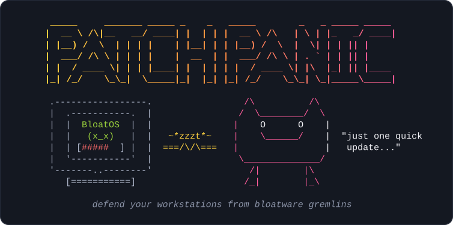

<p align="center">
  
</p>

<p align="center">
  <a href="https://github.com/kamranzafar/patch-panic/actions/workflows/ci.yml"></a>
  <a href="https://github.com/kamranzafar/patch-panic/actions/workflows/build.yml"></a>
  <a href="https://github.com/kamranzafar/patch-panic/releases/latest"></a>
  <a href="https://github.com/kamranzafar/patch-panic/releases"></a>
  <br>
  <a href="LICENSE"></a>
  
  
  <a href="https://pyga.me"></a>
</p>

A small arcade game in Python: bloatware gremlins sneak up to your workstations
and try to install BloatOS. Swat them before the install finishes. If one runs
off with a computer's OS, swat it so it drops the disk, then drag the disk back
onto the computer whose colour stripe matches. Power surges also race along the
network cables: click a spark before it reaches a machine, or the machine fries,
reboots, and ejects its OS disk, which you have to drag back before it expires.
Surges can jump on down the network, and a gremlin caught mid-install on a fried
machine gets zapped too. A ring fills up around every installing gremlin, and a
cable flashes just before a surge appears on it, so you can see what's coming.

Halfway through each level a golden patch flies across the screen. Click it for
bonus points plus a random power-up:

- **Firewall** – all gremlins freeze for 5 seconds
- **Surge Guard** – clears every spark and blocks new ones for 8 seconds
- **Auto-Patch** – instantly restores up to 2 broken computers
- **Antivirus Sweep** – your next 3 swats reach twice as far
- **Rollback** – every useful OS disk on the floor (or in your hand) flies home

Keep at least half your machines clean to survive each level. Finish a level
with every machine clean for a **perfect bonus** and a safety net: the next
level lets you finish with one fewer clean machine.

Each kind of gremlin has its own colour, and new kinds join in as the levels go on:

| Gremlin   | Colour                     | From level | Behaviour                                     |
|-----------|----------------------------|-----------:|-----------------------------------------------|
| Gremlin   | Pink                       | 1          | Installs BloatOS and steals the OS disk       |
| Sprinter  | Cyan                       | 3          | Fast and small, so harder to hit              |
| Armored   | Steel grey, gold horns     | 7          | Takes two swats (the first cracks its armour) |
| Splitter  | Amber                      | 11         | Splits into two sprinters when swatted        |

## Modes

- **Classic** – endless levels at the difficulty chosen in Settings
  (Relaxed, Normal or Frantic).
- **Daily** – everyone gets the same layouts for the day, always on Normal, so
  scores compare.
- **Tutorial** – a short guided level: swat, rescue a disk, zap a surge, recover
  from a surge that gets through (reboot and ejected OS), grab the patch.

Settings also has a colourblind mode (a shape on every OS disk and stripe),
screen shake, pausing when the window loses focus, and rebindable keys.

Runs on macOS, Windows and Linux. Graphics are pixel-art sprites (see below);
sound effects are synthesised at startup.

## Run

```bash
python3 -m venv .venv
# macOS/Linux:
.venv/bin/pip install -e ".[dev]"
.venv/bin/python -m patch_panic        # or: .venv/bin/patch-panic
# Windows:
.venv\Scripts\pip install -e ".[dev]"
.venv\Scripts\python -m patch_panic
```

`python run_game.py` also works (handy as a PyCharm run target).

## Controls

| Input        | Action                                    |
|--------------|-------------------------------------------|
| Left click   | Swat a gremlin / zap a surge / drag a disk |
| P            | Pause (rebindable)                        |
| M            | Mute (rebindable)                         |
| F / F11      | Toggle fullscreen (F is rebindable)       |
| 1 – 5        | Title menu: Classic, Daily, Tutorial, Scores, Settings |
| Esc          | Back to title (quit from title)           |

## Scoring

- Swat a gremlin: +10 (+25 if it was carrying a stolen OS)
- Zap a power surge: +15
- **Combo**: swats and zaps less than 1.2 s apart multiply their points
  (×2, ×3 … up to ×5); a missed click breaks the combo
- Close call: +20 for catching a disk thief in the last third of its escape
- Grab the golden patch: +100 × level
- Restore an OS to its computer: +50
- End of level: +10 × level for each clean computer
- Perfect level (every computer clean): +50 × level

The top-10 leaderboard (with arcade initials), unlocked achievements and your
settings are saved to `~/.patch_panic.json`. A version 1.0 file (just a high
score) is upgraded automatically.

## Project layout

```
patch_panic/
  app.py           App: window, main loop, switches between scenes
  scenes.py        Title / Settings / Scores / Play / Level complete / Initials / Game over
                   screens                                                (State pattern)
  tutorial.py      Tutorial scene and its steps                           (State pattern)
  world.py         World: all game rules for one level; emits events
  entities.py      Computer, Gremlin, Surge, Disk, PowerUp (state + behaviour, no drawing)
  powerups.py      Firewall / SurgeGuard / AutoPatch / AntivirusSweep / Rollback
                                                                          (Strategy pattern)
  events.py        EventBus + Event enum                                  (Observer pattern)
  audio.py         Synthesised sounds, subscribed to game events
  effects.py       Particles, popups, banner, shake, hit-stop, subscribed to game events
  stats.py         RunStats: per-game numbers, subscribed to game events
  achievements.py  Achievement list + tracker, subscribed to game events
  render.py        Renderer: draws everything, never changes game state
  config.py        Constants, colours, scoring, gremlin kinds, difficulty presets and
                   LevelConfig (difficulty per level)
  run.py           Run: mode, difficulty and seed of the current game
  settings.py      Player settings and key bindings
  storage.py       Save file: leaderboard, achievements, settings
  sprites.py   Pixel-art definitions + PNG export/loading
  assets/sprites/*.png
tests/         Unit tests for the game rules (no window needed)
tools/         make_readme_header.py: regenerates the README header (.github/header.svg)
               make_social_preview.py: regenerates the GitHub social preview image
               build_executable.sh: builds, launch-tests and packages a standalone app
               make_icon.py, smoke_test.py: app icon and launch test used by the build
```

How it fits together: `World` decides what happens and announces it on the
`EventBus` (e.g. `Event.COMPUTER_FRIED`). `SoundBank`, `Effects`, `RunStats`
and `AchievementTracker` subscribe to those events, and `Renderer` draws the
current state. So the rules never
touch pygame drawing or audio, and they can be unit-tested directly.

To tune difficulty, edit `LevelConfig.for_level()` (and the `Difficulty`
presets) in `config.py`. To add a power-up, subclass `PowerUpEffect` in
`powerups.py` and add it to `ALL_POWERUPS`. To add a gremlin kind, add a
`GremlinKind` to `Gremlins` in `config.py` plus its colours in
`sprites.VARIANT_PALS`. To add an achievement, add an entry to `ACHIEVEMENTS`
in `achievements.py`.

## Tests

```bash
.venv/bin/python -m pytest
```

## Sprites

All sprites are hand-authored pixel art defined as character grids in
`patch_panic/sprites.py`, and exported as 1x PNGs to
`patch_panic/assets/sprites/` (scaled 3x in game with nearest-neighbour
filtering, so they stay crisp).

- `python -m patch_panic.sprites` re-exports the PNGs and writes
  `patch_panic/assets/contact_sheet.png`.
- To change the art, edit any PNG in `patch_panic/assets/sprites/` (keep its
  pixel size). The game prefers a PNG when one exists and falls back to the
  built-in grid when it doesn't.

## Download

Ready-to-run builds are attached to each
[GitHub release](https://github.com/kamranzafar/patch-panic/releases), so you
don't need Python installed:

| System | Download |
|---|---|
| Windows 10/11 (64-bit) | `PatchPanic-<version>-windows-x64.zip` |
| macOS, Apple Silicon (M1 and later) | `PatchPanic-<version>-macos-arm64.zip` |
| macOS, Intel | `PatchPanic-<version>-macos-intel.zip` |
| Linux x86-64 (Ubuntu 20.04+, Debian 11+, Fedora 32+ or similar) | `PatchPanic-<version>-linux-x64.tar.gz` |

- **macOS:** the app isn't signed by Apple, so the first time, right-click
  `PatchPanic.app` and choose **Open**. If macOS says the app is damaged, run
  `xattr -dr com.apple.quarantine PatchPanic.app` and try again.
- **Windows:** SmartScreen may warn about an unrecognised app. Click
  **More info → Run anyway**.
- **Linux:** extract the archive (`tar xzf PatchPanic-*.tar.gz`) and run
  `./PatchPanic`.

## Building executables

The builds come from GitHub Actions (`.github/workflows/build.yml`):

- **Push a version tag** to build and publish a release:
  update `__version__` in `patch_panic/__init__.py`, commit, then
  `git tag v1.2.0 && git push origin v1.2.0`. The workflow checks that the tag
  matches the version, runs the tests, builds for Windows, macOS (Apple Silicon
  and Intel) and Linux, launch-tests each build, and attaches them to the release.
  Linux is built inside Debian 11 so it also runs on older distributions.
- **Run it by hand** from the Actions tab ("Build executables" → "Run
  workflow"). Enter an existing tag to attach builds to that release, or leave
  it empty to just build. The files are then under the run's **Artifacts**.

To build locally, use the same script as CI (PyInstaller only builds for the
system it runs on):

```bash
pip install -e ".[build]"
tools/build_executable.sh macos-intel   # or macos-arm64, windows-x64, linux-x64
# result: out/PatchPanic-<version>-<target>.zip (.tar.gz on Linux)
```

## License

Copyright (C) 2026 Kamran Zafar

Patch Panic is free software: you can redistribute it and/or modify it under
the terms of the GNU General Public License as published by the Free Software
Foundation, either version 3 of the License, or (at your option) any later
version. See [LICENSE](LICENSE) for the full text.
